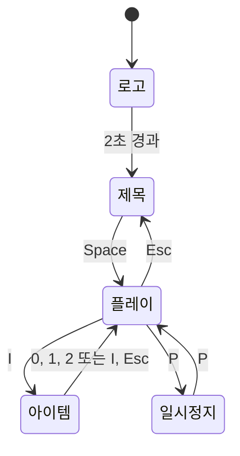

# 아이템 모드 요구사항

## 목표

기존 로고·제목·플레이·일시정지 흐름에 아이템 선택 모드를 추가한다. 플레이
도중 I를 누르면 `item_select.png`를 표시하고, 선택한 공을 이후 발사에 쓴다.

## 기능 요구사항

| 입력 | 동작 |
| --- | --- |
| 플레이 중 I | 아이템 선택 모드를 열고 플레이 업데이트를 일시 중지 |
| 아이템 화면에서 1 | `ball21x21.png`를 선택하고 플레이로 복귀 |
| 아이템 화면에서 2 | `ball41x41.png`를 선택하고 플레이로 복귀 |
| 아이템 화면에서 0 | 새 공 발사를 중지하고 플레이로 복귀 |
| 아이템 화면에서 I 또는 Esc | 기존 선택을 유지하고 플레이로 복귀 |
| 플레이 중 Space | 선택한 공을 현재 바라보는 방향으로 발사 |
| SLEEP에서 Space | 공을 발사하지 않고 IDLE로 복귀 |

초기 선택은 21×21 공이다. 새 선택은 이후 발사하는 공에만 적용하며, 이미
발사된 공의 이미지나 이동에는 영향을 주지 않는다. 0을 선택하면 기존 공은
계속 이동하지만 새 공은 생성되지 않는다.

## 상태 전환

아이템 선택 중에는 게임 오브젝트의 위치가 업데이트되지 않는다. 메뉴에 들어가기
전에 누른 방향키를 메뉴 안에서 놓으면 키 해제가 반영되어 복귀 후 소년이 계속
달리지 않는다. 창 닫기 이벤트는 아이템 화면에서도 게임을 종료한다.

## 구현 구성

- `LEC15_Game_Framework/item_mode.py`: 아이템 화면, 입력과 모드 복귀
- `LEC15_Game_Framework/play_mode.py`: I키로 아이템 모드 진입
- `LEC15_Game_Framework/boy.py`: 선택한 공 종류와 발사 여부 관리
- `LEC15_Game_Framework/ball.py`: 공 종류별 이미지와 기존 공의 이미지 유지
- `LEC15_Game_Framework/tests/test_item_mode.py`: 아이템 선택과 발사 회귀 테스트

## 완료 기준

1. I로 `item_select.png`가 표시되고 게임 월드는 정지한다.
2. 1, 2, 0을 차례로 선택하면 각각 작은 공, 큰 공, 발사 중지로 동작한다.
3. SLEEP에서 Space를 누르면 선택과 관계없이 깨어나기만 한다.
4. 이전에 발사된 공, 기존 방향키·일시정지·제목 화면 동작을 유지한다.
5. 테스트를 통과하고 Pico2D에서 로고부터 아이템 선택과 발사까지 실행된다.
